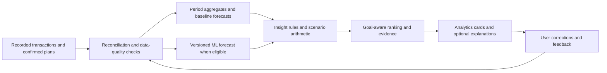

# FinTrack analytics AI blueprint

Prepared 22 October 2026 for students and salaried individuals tracking personal expenses.

This is a researched product and engineering proposal, not an implemented release. Evidence comes from the supplied screenshot, the repository, public discussions, product documentation, and research. No FinTrack customer interviews, production behavior logs, or representative customer dataset were analyzed. Research-derived hypotheses and proposed launch thresholds need validation with FinTrack users.

## 1. Product direction

Help a customer answer three questions in one short visit: What changed? What is likely to happen before my next funding date? What small action would help my chosen goal?

Build five capabilities: a spending outlook, savings scenarios, recurring-payment detection, unusual-spending review, and a goal-based weekly review. Use verified arithmetic and explainable statistical baselines first; introduce trained forecasting only after it beats those baselines on consented chronological data. An optional language model can explain approved results later.

Use “within your plan,” “above your chosen limit,” “flexible spending,” and “unusual for you.” A category, merchant, or large payment does not establish whether spending was good, bad, impulsive, necessary, or regretted. A student may depend on a canteen; a salaried customer may need taxis for a night shift. Ask what matters to the user.

## 2. Research and its implications

| Evidence | Observed signal | FinTrack requirement |
| --- | --- | --- |
| [IndiaInvestments expense-tracker discussion](https://www.reddit.com/r/IndiaInvestments/comments/1ad24wn/suggest_best_app_to_track_expenses_and_categorize/) | Participants describe manual effort, privacy concerns, category errors, and split/refund accounting difficulties. These are self-selected accounts, not measured market prevalence. | Keep fast entry and corrections; support optional imports; reconcile reimbursements and transfers before recommending savings. |
| [PersonalFinanceIndia discussion](https://www.reddit.com/r/personalfinanceindia/comments/1vmelag/anyone_else_stopped_using_finance_apps_that_read/) | Some participants favor manual entry, editable categories, exports, and control over access. The thread also contains product promotion, which is not independent validation. | Make automation optional. State where data is processed. Offer useful expense-only analytics without requiring bank/SMS access. |
| [YNAB spending-guilt discussion](https://www.reddit.com/r/ynab/comments/1bc1d92/ynab_is_the_best_thing_that_happened_to_me_but/) | A user describes improved finances alongside persistent spending guilt; replies discuss making room for personally valued spending. | Recognize intentional spending and progress, alongside opportunities to adjust. Ask about priorities instead of assigning moral labels. |
| [CFPB: Consumer Insights on Managing Spending, 2017](https://www.consumerfinance.gov/data-research/research-reports/consumer-insights-managing-spending/) | Participants found tracking burdensome and expressed interest in timely spending feedback. Interest in that research is not proof of FinTrack retention or savings impact. | Put a useful next action near the relevant decision, rather than only showing retrospective charts. |
| [Gladstone et al.: Financial Shame Spirals, 2021](https://www.joegladstone.com/papers/financial-shame-spirals) | Six studies connect financial shame, withdrawal, and financial hardship. This supports careful design; it does not prove the effect of a particular notification in this app. | Use neutral language; let users dismiss, correct, snooze, and set their own goals. Measure perceived judgment in interviews. |
| [Karlan et al.: Getting to the Top of Mind](https://www.nber.org/papers/w16205) | Field experiments support reminders as a possible savings intervention, including attention to specific future expenditures. Effects depend on context. | Test an optional, goal-specific weekly review. Measure usefulness and opt-outs rather than assuming more alerts improve outcomes. |
| [Monarch: Track recurring expenses](https://www.monarch.com/blog/track-recurring-bills-and-subscriptions) | The documented design combines recurring detection, a calendar, expected payments, and manual management. | Connect detection to a visible bill calendar and a confirmation workflow. This is a product precedent, not evidence that FinTrack should copy its implementation. |

## 3. Fix the analytics foundation first

The screenshot shows ₹5,790 recorded expenses, ₹0 recorded income, and a displayed savings rate of 0.0%. This establishes recorded activity, not the customer's real income, bank balance, or ability to save.

| Finding in current code/UI | Required behavior before intelligent recommendations |
| --- | --- |
| Savings rate becomes zero when recorded income is zero. | Return an unavailable state with a reason. Show “Add income to calculate a recorded savings rate,” or stay in expense-only mode. Do not issue a low-savings warning. |
| Net Balance is recorded income minus recorded expenses. | Label it “Recorded net cash flow.” Actual available cash requires account balances and reconciliation. |
| Analytics month comparisons check the month number without the year. | Use explicit local date boundaries and year-month keys, including January/December transitions. |
| The zero-baseline comparison returns 100% for any positive current amount. | Show “No comparable previous-period spending” or a rupee difference. Distinguish a complete zero-spend period from missing history. |
| The monthly chart sorts unpadded year/month strings lexicographically. | Sort numeric month-start timestamps. Test September–December ordering and year rollover. |
| Top-level totals are all-time while comparison badges use month-based calculations. | Apply one selected period consistently, or clearly label all-time versus month-to-date values. Compare equal elapsed periods for a live month. |
| Increasing expenses use the same green positive-change treatment as increasing income. | Describe direction neutrally and assess it against the user's own plan. An increase is not automatically good or bad. |
| Weekday totals aggregate recorded history without normalizing by observed days. | Use comparable periods and per-observed-day measures. Do not label unrecorded days as zero-spend days. |
| `/api/insights` uses all-time totals beneath “Monthly” headings and a fixed 20% savings warning. | Align periods, suppress income-dependent advice when inputs are absent, and compare with a self-chosen goal. |
| `predictedBalance` extrapolates current average daily expenses against income already recorded this month. | Describe this as a simple spending-pace projection, or replace it with the decomposition below. It is not a trained forecast or reconciled balance. |

Source files: [Analytics.jsx](</Users/admin36/Desktop/Expense Tracker/frontend/expense-tracker/src/pages/Dashboard/Analytics.jsx>), [AnalyticsService.java](</Users/admin36/Desktop/Expense Tracker/backend/src/main/java/com/expensetracker/features/analytics/application/AnalyticsService.java>), and [Transaction.java](</Users/admin36/Desktop/Expense Tracker/backend/src/main/java/com/expensetracker/features/transaction/domain/Transaction.java>).

The existing description classifier supports categorization. The existing insights endpoint is rule-based. Neither currently learns future expenses or financial preferences from a user's behavior. Personal category memory already provides explicit account-specific preferences and should remain authoritative.

## 4. Five prioritized capabilities

### A. Spending outlook and budget runway

Question: “What might I spend by month-end, or before my next allowance/payday?”

Start with confirmed upcoming bills plus a weekday-based baseline for remaining variable spending. Later compare quantile gradient-boosted regression against that baseline. Show a forecast range, its as-of date, observed history, assumptions, and confidence limitations. Missing history should produce an honest readiness message.

Forecast total spending as:

`posted spending so far + confirmed unpaid bills in the remaining horizon + forecast remaining variable spending`

Remove matched recurring payments from the variable-spending training series. A posted bill must leave the unpaid-bill set. Forecasted and recorded amounts must never be added twice.

Budget runway is a planning estimate against a confirmed budget. Available-to-spend cash is a separate future feature requiring a reconciled starting balance, confirmed inflows, upcoming obligations, a chosen buffer, and protection for essential variable expenses. Suppress that cash number if required inputs are missing. A positive month-end balance alone can conceal a cash shortfall before payday; a later cash feature needs a daily path.

### B. Savings opportunities with an editable scenario

Question: “What could I change without cutting something important to me?”

Start with user-selected flexible categories, a chosen limit, typical purchase amounts, and explicitly confirmed nonessential subscriptions. Compute scenarios deterministically. Let the user change the reduction and see the effect on a chosen goal.

From the screenshot, a 20% reduction of the ₹2,145 recorded outside-food spending equals ₹429 over that same recorded period. This is scenario arithmetic, not a forecast of monthly savings, an achieved saving, or evidence that the expense was unnecessary. Confirm the period before projecting forward.

Buttons: “Adjust scenario,” “Set a category limit,” “Keep this spending,” and “Not useful.” Do not add overlapping suggestions together: “reduce delivery orders” may overlap with “reduce outside food.” An affordable substitution must include its cost, not assume every avoided purchase becomes savings.

### C. Recurring bills and subscription review

Question: “Which payments repeat, and what is due next?”

Group by confirmed merchant identity, examine gaps between dates and amount variability, and distinguish weekly, monthly, annual, and irregular payments. Two similar payments can suggest a candidate; three or more consistent observations can strengthen it. These are provisional product rules to validate, not universal statistical guarantees.

Show the supporting transactions and ask for confirmation. Give options for recurring, one-time, reimbursable, and incorrect merchant matches. Confirm existing manually scheduled bills before adding inferred ones. Link an actual payment to its expected bill so processing a schedule or importing statements cannot duplicate the expense.

Do not infer “unused subscription” from bank transactions: they establish billing, not product usage. Ask the user whether it is still useful. Cancellation can be a user action outside the app; no automatic cancellation is part of this proposal.

### D. Unusual spending and changing patterns

Question: “Is anything different enough to review?”

Use robust medians, dispersion, comparable weeks, and category/merchant baselines first. Consider Isolation Forest only as a later challenger with enough relevant history and reviewed examples. [Its documented purpose is outlier detection](https://scikit-learn.org/stable/modules/generated/sklearn.ensemble.IsolationForest.html); an outlier is not proof of fraud or waste.

Show “larger than your usual transport payments,” with date range and evidence. Allow “Expected,” “One-time,” “Reimbursable,” or “Wrong category.” Planned tuition, medical spending, travel, festival expenses, and work-required transport need context. Avoid late-night or emotional-spending claims: a manually entered transaction date is not reliable purchase-time or emotional-state evidence.

### E. A goal-based weekly review, including positive progress

Question: “What went well, and what one thing should I consider next?”

Show at most three useful observations: one verified improvement, one upcoming commitment, and one optional action toward a chosen goal. Compare with a personal target or comparable past period. Avoid universal savings quotas and judgments about the customer.

For students, use allowance cycles, hostel/canteen costs, shared reimbursements, exam fees, and term expenses. For salaried users, use payday cycles, rent, confirmed EMIs, commuting, and buffers. A customer can select a profile, but assumptions must remain editable; do not infer an identity or lifestyle from a merchant name.

Start with factual templates. An optional language model can later explain approved facts or answer “Why did this change?” using scoped, read-only tools and links to evidence. It must not invent amounts, classify people psychologically, or perform money movements.

## 5. Proposed Analytics screen

Keep the current visual style and use three tabs: Overview, Plan ahead, and Your patterns. Reuse one insights engine for Analytics, the Overview summary, and the existing Insights page to prevent conflicting advice.

1. Period/cycle selector, last-updated time, and tracking-completeness status.
2. Recorded spending, remaining confirmed budget, spending outlook when ready, and goal progress. Income-dependent metrics appear only when supported.
3. “What is worth knowing”: up to three ranked cards with badges for Observed, Estimate, or Scenario.
4. Actual spending chart with a visually separate forecast range and a clear today marker. Missing observations remain distinguishable from verified zero-spend days.
5. Savings scenario control, upcoming-payment calendar, and pattern details.
6. Every card offers “Why am I seeing this?”, supporting transactions, an action, and corrective feedback.

Use user-controlled, opt-in reminders. Start with one optional weekly digest and only separately opted-in bill reminders. Deduplicate repeated insights and respect dismissal and snooze preferences. Notification limits are a hypothesis to test, not an established optimal frequency.

## 6. Data and behavior requirements

Preserve existing transaction IDs and audit history. Add these concepts through reviewed migrations rather than rewriting historical categories:

| Data | Why it is needed |
| --- | --- |
| Transaction date, amount, currency, type, account/source, import identity | Correct period totals, reconciliation, and duplicate handling. |
| Merchant identity and editable normalization | Group repeat payments without merging different merchants or purposes. |
| Expense, income, own-account transfer, refund, reimbursement, bill settlement | Prevent credit-card payments or internal transfers being counted as new consumption. |
| Original-transaction link and user's own share | Handle shared expenses and returned purchases fairly. Keep gross cash movement separate from personal consumption. |
| Category source, confidence, personal rule, and confirmed correction | Preserve the distinction between predicted and user-confirmed facts. |
| Expected-payment ID and posted-payment match | Avoid double counting actual and scheduled bills. |
| Confirmed coverage dates and tracking method | Missing entry must not become assumed zero spending. Manual users can mark periods incomplete. |
| Budget cycle, next funding date if known, goals, protected categories, optional opening balance | Personalize planning without assuming a salary or account balance. |
| Insight feedback and model/feature version | Understand relevance, corrections, and regressions. |

I did not find a dedicated behavior-event pipeline in the inspected source. Introduce minimal events such as `insight_viewed`, `evidence_opened`, `scenario_changed`, `plan_saved`, `insight_dismissed`, and `weekly_review_completed`. Record an opaque insight ID, event time, model version, and optional feedback reason. Do not include raw descriptions, amounts, merchant names, or credentials in third-party event payloads.

Events indicate interaction, not causation or achieved savings. A clicked button does not prove a behavior change. Separate essential operational records from optional product analytics and shared-model-training consent. Pseudonymous IDs still require privacy controls; they do not make records anonymous.

## 7. Model plan and training process

| Layer | Initial implementation | Later candidate | Decision gate |
| --- | --- | --- | --- |
| Categorization | Existing TF-IDF/logistic regression plus explicit personal memory | Improve independently using verified corrections | Do not substitute category training data for forecasting histories. |
| Recurrence | Merchant grouping, interval and amount checks, customer confirmation | Supervised recurring-probability model | Enough confirmed recurring and non-recurring examples; false positives remain low. |
| Variable-spend forecast | Weekday baseline and confirmed commitments | Quantile gradient-boosted regression | Beats the baseline on chronological tests for both target groups and passes interval calibration checks. |
| Pattern review | Robust personal baselines and explicit exceptions | Isolation Forest challenger | Better reviewed alert relevance than the simpler rules. |
| Insight selection | Goal relevance, materiality, evidence quality, novelty, dismissals | Learned ranking | Enough consented feedback; avoid optimizing only click-through. |
| Explanation | Deterministic templates with evidence | Read-only LLM explanations | Numeric fidelity, privacy controls, factual grounding, and acceptable latency/cost. |

[Scikit-learn supports quantile regression in histogram gradient boosting](https://scikit-learn.org/stable/modules/generated/sklearn.ensemble.HistGradientBoostingRegressor.html). This makes it a candidate for tabular forecasting features, not a proven best model for FinTrack. Features can include past 7/28-day variable spend, frequency, weekday, cycle position, and commitments known at prediction time. Do not use future transactions, later corrections, or bills discovered after the forecast as training-time knowledge.

1. Recruit a consented pilot and establish data ownership, deletion, and training consent.
2. Import available historical records with local redaction where appropriate. Reconcile transfers, splits, refunds, and duplicates; confirm coverage and categories.
3. Produce user/date/category aggregates and an explicit missing-data mask. Keep actual purchase dates separate from entry dates where known.
4. Save simple baseline forecasts before fitting a challenger.
5. Use chronological rolling-origin tests at the intended 7-day and month-end horizons. Hold out entire users separately to assess generalization to new accounts. A random split of transaction rows is unsuitable for this task. See [Forecasting: Principles and Practice, evaluation and cross-validation](https://otexts.com/fpp3/toolbox.html).
6. Measure rupee MAE, aggregate WAPE where actual total spending is nonzero, bias, interval coverage and width, and performance by history length, profile, and spend variability. Handle zero/near-zero denominators explicitly.
7. Calibrate prediction ranges on held-out time periods. A displayed “80% prediction interval” needs evidence of approximately that coverage; an arbitrary low/high band is not a calibrated interval. See [prediction interval guidance](https://otexts.com/fpp3/prediction-intervals.html).
8. Version the data snapshot, model, thresholds, and evaluation report. Run shadow forecasts, then an opt-in pilot behind a feature flag; retain baseline fallback and rollback.

Provisional readiness policy: show facts and user-entered plans immediately; consider a baseline outlook after roughly 4–8 weeks of confirmed coverage and enough relevant transactions. Two or more cycles help assess monthly recurrence. Three to six months of historical imports can accelerate a pilot, but do not guarantee forecast accuracy. Annual seasonality needs longer observation or explicit future plans. Final readiness rules must follow measured errors, not a transaction-count promise.

The current 651 description examples cannot train expenditure forecasting. Synthetic histories are useful for testing edge cases but must not be presented as customer-validation evidence. A small pilot can validate usability; pooled model training requires a sufficiently diverse consented corpus and separate evaluation. If there is insufficient evidence, keep the baseline or suppress the forecast.

## 8. Architecture and proposed API contract

Keep authentication, ownership checks, exact monetary arithmetic, and insight eligibility in Spring Boot. Python receives only the scoped features needed for the relevant task. Cache derived results per account, selected period, data revision, and model version; invalidate after relevant edits, imports, budget changes, and corrected bill matches, and expire forecasts at local date rollover and relevant due-date boundaries. Load recorded totals first and defer forecast cards so a model outage cannot block the page.

Proposed endpoints, not implemented: `GET /api/analytics/summary`, `GET /api/analytics/forecast`, `GET /api/analytics/insights`, `POST /api/analytics/scenarios`, `POST /api/analytics/insights/{id}/feedback`, and explicit confirmation of inferred recurring candidates. Scope every resource to the signed-in account. Keep existing dashboard/report consumers compatible while migrating.

An insight response should carry: ID, kind (observed/estimate/scenario), selected period and timezone, as-of timestamp, data-readiness reason, numerical inputs/outputs, uncertainty where meaningful, evidence IDs, assumptions, model/method version, and allowed actions. Monetary values need a consistent decimal contract. Server-side eligibility checks prevent unsupported claims even if an explanation generator fails.

If a hosted LLM is later introduced, disclose and obtain the required consent before sending financial context outside the existing services. Prefer minimal computed facts over raw statements and descriptions. Treat transaction text as untrusted data; it cannot instruct a tool or bypass account scope. Validate every numerical claim against the supplied structured facts; fall back to templates on failure. Do not claim end-to-end encryption while servers process readable financial records.

## 9. Delivery sequence

Illustrative engineering sequence for one developer familiar with the project. These are planning estimates, not release promises; data collection and validation can take longer.

| Stage | Approximate effort window | Deliverable and exit condition |
| --- | --- | --- |
| Foundation | Weeks 1–2 | Correct periods, zero-income states, calendar order, net-cash-flow labels, transfer/refund/split handling, and coverage status. Exact reconciliation and edge-case tests pass. Interview five students and five salaried users where feasible. |
| Useful insights MVP | Weeks 3–4 | Confirmable recurrence, comparable-period observations, goal-based positive feedback, and editable savings scenarios. Each card has evidence and a clear action. Pilot users can explain what the numbers mean. |
| Forecast pilot | Weeks 5–6 or later when data is ready | Baselines, chronological evaluation, uncertainty, and a challenger only if justified. Shadow forecasts beat or retain the baseline according to a preregistered evaluation plan. |
| Personalization and explanation | Weeks 7–8 or later | Feedback-aware ranking, optional digest, and optional grounded explanations. Expand only after usefulness, numeric correctness, privacy, latency, and alert relevance meet the pilot gates. |

Start by centralizing period calculations and an evidence-backed insights contract. Preserve the existing categorization and category-memory workflow. Do not introduce several new models and a chatbot in the first release; each capability needs its own measurable benefit.

## 10. Success measures and release gates

The primary proposed product outcome is completion of a useful weekly review and a customer-chosen next action, with low correction effort. Track comprehension and usefulness alongside return visits; maximizing visits alone can reward anxiety.

Before broad release require exact summary reconciliation; no income-dependent assertion when income is absent; no unsupported actual-balance claim; evidence for every generated number; tested account isolation; chronological forecasting evaluation; meaningful ranges; and clear fallback states. Compare forecast errors with the best simple baseline at the same horizons. Set improvement targets after measuring the baseline rather than advertising an invented accuracy percentage.

For the opt-in pilot, measure alert confirmations and false positives, dismissals/reasons, time to understand a card, plan acceptance and follow-through, weekly-review completion, and notification opt-outs. Savings measurements need comparable complete periods and treatment of refunds and one-time events. Reduced recorded spending alone is not causal proof of money saved; users may have stopped entering expenses. A sufficiently powered randomized or staged evaluation is needed for causal savings claims.

Interview prompts: “What decision did this help you make?”, “What was wrong or missing?”, “Was this expense necessary or planned?”, and “Did this wording feel judgmental?” Small interviews uncover usability problems; they do not establish market-wide demand or model accuracy.

## 11. Inputs needed from the owner

1. Use the already selected audience: students and salaried users. Confirm typical allowance/payday schedules and include an editable funding cycle; expense-only mode remains supported.
2. Select an initial customer-chosen goal: category limit, funding a purchase, or building a buffer. Avoid a mandatory universal savings percentage.
3. Where available, prepare 3–6 months of consented, sanitized history for local development: transaction date, amount, currency, type, description/category, source, and relevant transfer/refund links. Remove names, account/card numbers, UPI IDs, OTPs, tokens, and secrets. Keep unredacted statements out of Git and third-party telemetry.
4. Provide examples of expenses that were essential, intentionally enjoyable, regretted, reimbursed, and irregular. These labels must come from the customer rather than the model guessing motives.
5. Recruit a small pilot spanning students and salaried users, including manual-entry users and irregular-income situations. Obtain separate permission for product research, analytics, and shared training where applicable.

No new dataset or paid language-model account is required to begin the foundation and deterministic-insights stages. This document does not change the application, commit files, deploy services, or send messages to customers.
