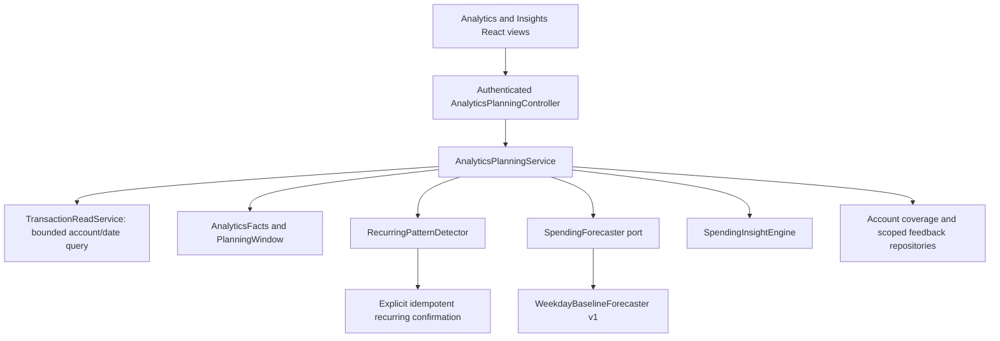

# Analytics planning v1 — implementation and release guide

Implemented locally on 22 October 2026. This document describes the first working release, not every future capability in the research blueprint.

## Boundaries

The backend remains a modular Spring Boot application. Feature ownership and dependency direction are enforced by the existing ArchUnit suite: controllers call application services, persistence stays private to its feature, and features cannot form cycles. No new infrastructure or paid service is required.

`AnalyticsPlanningService` assembles the response from account-owned data. Calendar calculations use the configured application timezone and full year/month boundaries. Monetary operations use BigDecimal. Historical months contain recorded facts, not retrospective forecasts generated with later information. The selected live month compares equal calendar-date counts with the preceding month, with the current day still in progress; completed months compare complete months. Growth is unavailable without confirmed comparable coverage and a positive prior amount.

Recorded net cash flow is not available bank balance. Savings rate is null when recorded income is zero. Unconfirmed empty days remain null in chart data. The previous dashboard `predictedBalance` field is retained but now null; consumers must use the explicit planning outlook rather than the retired naive balance projection. `/api/insights` retains its transport but uses the same period-aware engine; both React views use `/api/analytics`.

## Implemented behavior

- Period-scoped recorded totals, categories and daily activity, including historical months and timezone boundaries.
- Exact, read-only category-reduction scenarios with optional owner-validated goal impact, capped at the remaining target amount. No goal contribution is written. They are same-period hypothetical reductions; no achieved-savings claim, recurring monthly extrapolation, or assumption that replacements are free.
- Versioned weekday baseline: at least 28 consecutive explicitly confirmed history days through yesterday, up to 56 days, and at least 12 recorded expenses. These are initial eligibility guards, not established accuracy guarantees. Forecast starts tomorrow; today's later spending is not estimated. No calibrated uncertainty interval is claimed.
- Upcoming active scheduled bills, separately summed; unresolved due-today/overdue schedules block the outlook. Generated recurring entries carry `recurringScheduleId` and are removed from the variable baseline; legacy generated titles are also recognized. Already-posted deterministic occurrences are not scheduled twice. Candidate confirmation stores exact supporting transaction IDs privately on the schedule; those payments are excluded from the variable baseline without changing ledger records or excluding every purchase at that merchant.
- Conservative weekly/monthly recurring candidates based on at least three distinct dates, exact normalized descriptions and similar amounts. Customers explicitly confirm a proposed amount/frequency/date. Confirmation is idempotent through deterministic account/candidate IDs and Mongo's unique `_id`; no ledger expense is created. Existing schedules, including paused schedules, suppress duplicate suggestions.
- Category-based unusual-payment review with at least five earlier observations, robust median/dispersion checks, a materiality floor, evidence, and neutral language. No fraud, intent, subscription-usage, or psychological claims.
- Budget observations, coverage-gated seven-day comparisons, current savings-goal progress, and owner-scoped helpful/dismissed/expected feedback. Feedback adjusts visibility, not a hidden global training dataset.

## API contract

All endpoints require the existing bearer authentication. The account comes from the authenticated principal; callers cannot select another account ID.

| Method | Route | Purpose |
| --- | --- | --- |
| GET | `/api/analytics?month=YYYY-MM` | Versioned facts, coverage, outlook, recurring candidates, evidence, goals and insights. Future months are rejected. |
| PUT | `/api/analytics/coverage` | Explicit `{from, through}` attestation; future and reversed ranges are rejected. |
| DELETE | `/api/analytics/coverage` | Clear tracking attestation; no expense is removed. |
| POST | `/api/analytics/scenarios` | `{month, category, reductionPercent, goalId?}`; validates 0–100 and an account-owned recorded category. |
| POST | `/api/analytics/insights/{id}/feedback` | `{month, response}` where response is helpful/dismissed/expected; only a currently generated owned insight is accepted. |
| POST | `/api/analytics/recurring-candidates/{id}/confirm` | `{month}`; current-month owned candidate confirmation, safe on retry. |

Forecast readiness is `ready`, `needs_history`, `review_due_bills`, or `historical`. Every forecast carries method, version, assumptions and history length. Insights distinguish observed facts from scenarios/estimates. Evidence includes up to six recent supporting entries; “View supporting transactions” explains that limit.

New collections: `analyticscoverage` has one `_id` per account; `insightfeedback` uses deterministic account/period/insight `_id` values. Feedback reads use a bounded set of `_id` lookups, so no new secondary-index build is required. Transaction reads are bounded to the selected cutoff and 180 earlier days through an account/date range query; use the existing `user_date` index in production. Scenario reads use only the selected period. No raw transactions or financial amounts are sent to third-party analytics.

## ML lifecycle

The Java forecasting port separates orchestration and transport from the calculation. The first adapter is deliberately a transparent statistical baseline. `ml-service/forecasting/backtest.py` adds a standalone chronological evaluation runner with data fingerprinting and missing-data/leakage checks. It does not train or promote a customer model. The category classifier is unchanged.

A later Python forecast adapter should receive only a versioned aggregate feature contract through authenticated bounded requests. It must validate target horizon and units, fail back to the baseline/readiness response, and never block recorded facts. Before promotion, require chronological and held-out-user evaluation, comparison against the baseline, subgroup checks, calibrated intervals where shown, privacy review and a rollback artifact. No training on live customer records is implicit in accepting feedback or confirming coverage.

## Operational limits

This release is a useful planning MVP, not a reconciled banking platform. Imported fixed bills without schedule links may overlap with the variable baseline. Transfers, refunds, split reimbursements, duplicates, multi-currency data and true account balances are not automatically reconciled by this release. The UI requires tracking/reconciliation confirmation and states these limitations. Do not market the outlook as safe-to-spend cash or guaranteed savings.

Merchant-wide fuzzy matching, annual/irregular recurrence, candidate rejection memory, funding-cycle customization, notification delivery, persistent insight history, trained expenditure forecasting and LLM explanations remain future work. Current goal progress is not a historical weekly contribution calculation. Feedback is period-scoped and is not an immutable training-event archive. The default UI still uses the monthly calendar.

Data is derived on request, avoiding stale caches and premature queues/microservices. There is no shared mutable forecast cache or external model call in this first release. At larger scale, move aggregates behind indexed projections and add per-account revision/date/model-version cache keys, invalidation on all relevant writes and timezone date rollover, request metrics without financial payloads, and measured latency budgets. Confirm data-volume limits before expanding the 180-day query horizon.

## Validation and rollout

Backend tests cover account isolation, zero income, invalid periods, exact scenario arithmetic, explicit coverage, feedback ownership, idempotent recurring confirmation without expense creation, timezone boundaries, sparse history, overdue bills, recurring exclusion and month-end anchors. Existing feature architecture checks remain enforced. Frontend request tests cover credentials, errors, 204 acknowledgments, timeouts and cancellation. Offline backtest tests cover future leakage, missing coverage, account separation and refusal to invent metrics without eligible windows.

Run `./mvnw clean verify` from backend; run `npm test`, `npm run lint`, and `npm run build` from the frontend; run `python -m unittest forecasting.test_backtest -v` from ml-service. CI includes the Python baseline checks.

Deploy backend first, verify authenticated planning endpoints, then release the frontend. The frontend gives an actionable deployment message if the new route is missing. Test coverage confirmation, scenarios and recurring confirmation with a disposable account before enabling for customers. No database backfill or automatic recategorization is required. An older frontend can still use the existing routes. Roll back frontend first if the planning API must be removed.

### Local acceptance results

Final backend verification: **55 tests, zero failures/errors/skips** (`spotless:apply clean verify`). Frontend: **40 tests**, ESLint and production build passed. Forecast evaluator: **4 tests passed**. These checks validate behavior and isolation; they do not measure real customer forecast accuracy.

A browser acceptance check used the actual built frontend and backend against an isolated in-memory Mongo database, with synthetic transactions only. Verified:

- ₹4,430 category spend at 20% produces ₹886 potential reduction and ₹3,544 adjusted spend.
- A selected ₹40,000 goal shows ₹39,114 remaining only as a hypothetical scenario; recorded goal contributions stay unchanged.
- A weekly candidate becomes one scheduled payment; posted spending remains ₹6,026. Exact source-payment IDs prevent variable-baseline double counting.
- Clearing tracking coverage replaces the forecast with an eligibility explanation; reconfirming complete dates restores it.
- Marking an unusual payment “expected” saves feedback and removes that review.
- Desktop and narrow-layout views retain readable controls, evidence and distinct observed/scenario/estimate labels.

These results describe local acceptance, not proof of a successful production deployment. After publishing the commit, verify GitHub workflow results and deployed endpoints. Release the verified backend before the frontend as described above.
