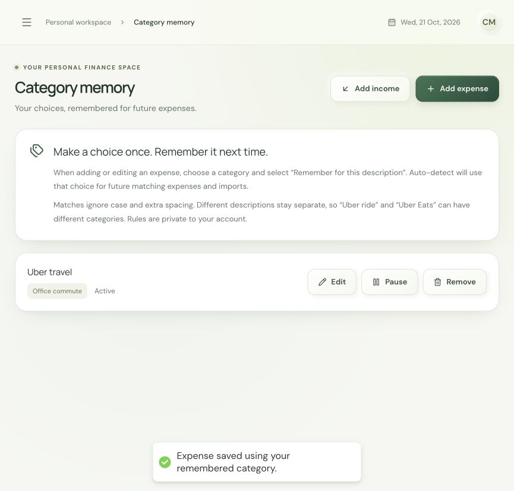

# Personal category memory: first implementation

Implemented on 21 October 2026. Deployment status must be verified separately from the GitHub push.

## Try it step by step

1. Add or edit an expense with a clear description, such as `Uber travel`.
2. Choose the category you want. Use **Add category** if you want a personal label such as `Office commute`.
3. Select **Remember for this description**, then save the expense. The confirmation tells you whether the expense and its memory rule were saved.
4. Add another expense with the same description and leave its category on **Auto-detect**. The remembered category is applied automatically. For example, `UBER   TRAVEL` matches `Uber travel`.
5. Open **Category memory** in the navigation to edit, pause, resume, or remove the rule. Changes affect future Auto-detect saves and imports; existing transactions retain their categories.
6. For an exception, choose a different category and leave **Remember for this description** unchecked. That changes only the current expense. To replace the future preference, check the box again.

Rules match an entire description after Unicode compatibility normalization, lowercasing, and whitespace normalization. Punctuation, numbers, and qualifiers remain meaningful. `Uber Eats` does not match `Uber travel`. This version does not infer merchant-wide or fuzzy rules from one correction.

## How categorization now works

The order is: an explicit category selected for this expense, then an active personal rule for the description, then the existing shared ML model. Uncertain model results still require review. Personal rule matches carry `categoryStatus: remembered` and do not pretend to have a model probability.

Each rule belongs to the signed-in account. Custom categories are checked against that same account. CSV imports use personal rules for uncategorized expenses, preserve explicit categories, and never create new memory rules. Income and manually scheduled recurring transactions retain their existing behavior.

Explicit category changes on an expense retain the previous category, suggestion status, model score, description at correction, and timestamp alongside the expense. The latest 20 changes are kept per expense; this is a bounded correction history, not a complete training-event archive. It is shown when editing that expense. Neither an untouched prediction nor an imported label is treated as a confirmed training example.

If an expense saves but saving its rule fails, the response reports `categoryRuleSaved: false` and the UI explains that the expense already exists. Edit that expense to retry remembering; do not add it again. Memory writes are not queued for automatic retry in this version.

## What I need from you next

No dataset or paid AI account is needed for personal memory. To improve the shared model's handling of unfamiliar descriptions, provide 5–10 anonymized examples in this format:

| Description | Expected category |
| --- | --- |
| Uber travel | Your preferred label: Transport, Travel, or a custom category |
| College canteen lunch | Food |
| Hostel room rent | Rent |
| Monthly mobile recharge | Utilities |
| Semester tuition | Education |

These are illustrative examples, not collected customer records. Replace them with descriptions that actually cause problems. Omit account numbers, UPI identifiers, passwords, tokens, and personal names. Choose labels consistently: commuting can be `Transport`, while an outstation trip can be `Travel`; personal rules can retain a customer's different preference.

A few examples help diagnose errors; they do not establish production accuracy. Broader model training needs a larger, consented, verified corpus with separate evaluation examples. Personal preferences remain account-local and are not sent into shared retraining automatically.

## Validation and release

Backend verification passed 42 tests, including account isolation, custom categories, corrected-history persistence, rule updates, pause/resume/delete, imports, invalid requests, model outages, and partial memory-save failure. Frontend tests passed 35 checks; production build and lint passed. Browser checks used the actual frontend and backend with an isolated in-memory database and synthetic expenses, including custom category creation and an automatic subsequent match.

Deploy the backend before the frontend so the new memory API is available when the controls appear. This release adds a `categoryrules` collection and its unique account/normalized-description index. Production skips automatic index creation, so the rule service explicitly ensures this index before the first rule write, outside HTTP startup. If index creation fails, the expense remains saved and the UI reports that its memory rule could not be saved. Existing transaction documents require no backfill. Keep the current ML service/model unchanged for this release. Verify in a test account before promoting to customers.

Current endpoints: `GET /api/category-rules`, `PUT /api/category-rules/{id}`, and `DELETE /api/category-rules/{id}`. Rule creation is explicit through `rememberCategory: true` on the existing expense create/update request. Editing a rule cannot take ownership of another account's rule. Removing or pausing a rule returns future Auto-detect to the shared model.
